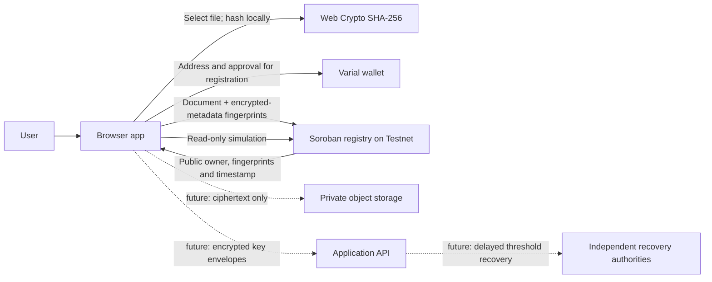

# VAULTORA

VAULTORA is a Phase 0 foundation for checking document integrity with Stellar and Soroban. It calculates a SHA-256 fingerprint in the browser, then can register that fingerprint and an externally created encrypted-metadata fingerprint in a Soroban registry. The original document is not uploaded.

## What works now

| Area | Current status |
| --- | --- |
| Browser app | React and TypeScript dashboard; hashes selected files locally with Web Crypto. |
| Wallet | Connects to the Varial wallet and shows the actual connected address. |
| Registration | Builds the registry call with fixed 32-byte fingerprints and owner address, asks the wallet to authorize it, then reports only a hash returned by the RPC. Requires the deployed contract ID and a separate fingerprint for metadata encrypted outside this app. |
| Verification | Simulates a read-only registry call for the connected owner and document fingerprint. It does not sign or submit a transaction. |
| Contract | Soroban registry with owner authorization, duplicate protection, record lookup, minimal registration event, and explicit initial persistent-storage TTL extension. |
| Testnet deployment | Deployed and read-only verified on 2026-11-20. Contract ID and real transaction evidence are in [`docs/TESTNET_DEPLOYMENT.md`](docs/TESTNET_DEPLOYMENT.md). No Mainnet use is supported. |

Project spaces, saved links, file encryption, encrypted object storage, a backend, recovery, registry indexing and transaction-history indexing are not implemented. The dashboard labels these gaps instead of showing fabricated records.

## Architecture



The selected file stays in the browser for hashing and is not persisted by this app. Registry fingerprints and owner addresses are public and can be correlated; a document fingerprint may also be guessable for predictable content. The registry stores the document fingerprint, a fingerprint of encrypted metadata, the owner address and registration timestamp—not the document or metadata itself. The metadata fingerprint is supplied by the user; VAULTORA does not encrypt metadata.

## Run and verify locally

Use Node.js `24.22.x`, pnpm `11.25.0`, Rust `1.97.1`, and the `wasm32v1-none` target. The Rust toolchain and Node version are pinned in the repository. Stellar CLI `30.0.1` is used for Wasm builds.

```sh
pnpm install --frozen-lockfile
pnpm run web:dev
```

The app opens at the local Vite URL printed in the terminal. To run the checks:

```sh
pnpm run web:check
cargo fmt --all -- --check
cargo clippy --workspace --all-targets -- -D warnings
cargo test --workspace
stellar contract build --locked --package document-registry
```

`pnpm run verify` runs the web checks, Rust formatting and contract tests, and a locked contract build. CI additionally runs Clippy and a secret scan. The Soroban SDK version is locked at `29.0.1`; JavaScript SDK and wallet dependencies are pinned in the pnpm lockfile.

## Connect the Testnet contract

The browser contract ID is blank by default. Copy `apps/web/.env.example` to `apps/web/.env.local` and set `VITE_STELLAR_CONTRACT_ID` to the deployed Testnet contract ID shown in [`docs/TESTNET_DEPLOYMENT.md`](docs/TESTNET_DEPLOYMENT.md). This local environment file is ignored by Git. The RPC and network passphrase default to Stellar Testnet values. Never place seed phrases, secret keys or other credentials in Vite variables.

For the guarded identity, build, deploy and read-only verification workflow, follow [`docs/TESTNET_DEPLOYMENT.md`](docs/TESTNET_DEPLOYMENT.md). The scripts are Testnet-only and use a dedicated CLI identity alias. Review their output and local key storage before use; a successful local Wasm build is not a deployment. Testnet accounts and records can be reset.

Persistent contract storage has a TTL. The contract extends a newly registered record to the network's current maximum TTL, but this does not make the record permanent: it will need later renewal, and Testnet resets can erase it. See the official [Soroban storage archival guidance](https://developers.stellar.org/docs/learn/fundamentals/contract-development/storage/state-archival) and our [`docs/FOUNDATION_RESEARCH.md`](docs/FOUNDATION_RESEARCH.md).

## Security and limits

Do not use real documents or Mainnet funds with this experimental foundation. Never put original files, names, passwords, private keys, recovery secrets or plaintext metadata on-chain. A raw SHA-256 fingerprint is not encryption or proof that the file is safe. There is no encryption or recovery implementation: the recovery document is a design and threat model, not an available feature.

This foundation has not received an independent security audit. Public Testnet state is experimental and may disappear. Read [`docs/ARCHITECTURE.md`](docs/ARCHITECTURE.md), [`docs/SMART_CONTRACTS.md`](docs/SMART_CONTRACTS.md), and [`docs/RECOVERY_DESIGN.md`](docs/RECOVERY_DESIGN.md) before extending the data model or handling sensitive material.
