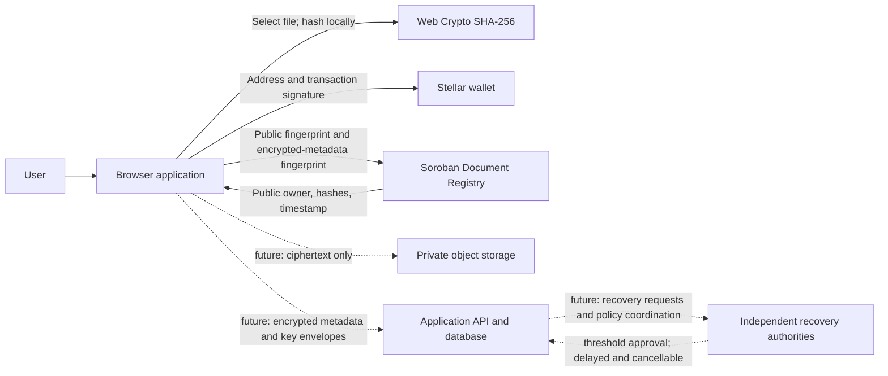

# VAULTORA Architecture

## Phase 0 component map

Solid flows describe the intended Phase 0 foundation; dashed flows are future architecture and are not represented as deployed services. The browser must not transmit the selected plaintext file to an API or blockchain.

## System responsibilities

| Component | Responsibility | Trust boundary |
| --- | --- | --- |
| Browser app | User interface, local SHA-256 calculation, future client-side encryption, and public contract calls | Untrusted device/browser; never assume browser code is secret from its operator |
| Stellar wallet | Supplies an address and signs a transaction or authorization entry | Wallet controls signing; the app must not hold a user's private key |
| Soroban registry | Stores document integrity records and emits public events | Public, durable only subject to ledger/storage lifecycle and network rules |
| Future private object store | Stores encrypted file bytes only | Store is not trusted with plaintext or decryption keys |
| Future application API/database | Stores non-secret organization and encrypted object references | Must not be a key-derivation or decryption authority |
| Future recovery authorities | Independently approve a delayed threshold recovery protocol | Authorities may be unavailable, compromised, colluding, or mistaken |

## On-chain versus off-chain data

### Soroban may contain

- Authenticated owner address.
- Original document SHA-256 fingerprint.
- Fingerprint of encrypted metadata.
- Registration ledger timestamp.
- Minimal registration event data.
- In a later, separately reviewed protocol: narrowly scoped access or recovery policy commitments.

These values are public and can be copied, indexed, and correlated. A raw SHA-256 document fingerprint can reveal equality across users or enable guessing of predictable documents.

### Keep off-chain

The original file; plaintext names; user email/phone and identity profile; encryption keys; recovery secrets or shares; key envelopes; object-storage credentials; access tokens; detailed audit and session records; private sharing metadata; notes; and any private recovery approvals.

## Planned data model

The application database is not implemented in Phase 0. A future normalized model should include:

- `users`: internal immutable identifier, creation state, and account lifecycle.
- `authentication_identities`: provider, provider subject, verification time; never an encryption key.
- `registered_devices`: device public key, registration state, and revocation history.
- `smart_sessions`: limited scope, expiry, revocation, and originating owner authorization.
- `vaults`: owner, key-envelope references, state, and version.
- `encryption_key_envelopes`: encrypted key material, algorithm/version, recipient and wrapping context; no plaintext key.
- `recovery_authorities`: authority public identifiers, status, and proof-of-control metadata.
- `recovery_policies`: threshold, authority set, delay, protocol version, and policy hash.
- `recovery_requests` / `recovery_approvals`: state machine, challenge, approvals, deadlines, and cancellation record.
- `workspaces`: owner, title-encryption envelope/reference, and membership policy.
- `documents` / `document_versions`: opaque identifiers, encrypted display metadata, storage references, and Soroban record reference.
- `encrypted_object_references`: provider, opaque object key, ciphertext size, and encryption format; no decryption key.
- `bookmarks` / `notes`: encrypted payloads or client-encrypted references.
- `sharing_permissions`: recipient key, object scope, rights, expiry, and revocation status.
- `audit_events`: minimal, append-only operational events with retention and privacy controls.

Avoid unnecessary personal data and never place private document content or keys in a database row that an operator can read in plaintext.

## Evolution path

1. Keep the registry small and stable; test its authorization and public data surface.
2. Add a reviewed browser encryption module and offline/tamper tests before connecting object storage.
3. Define versioned key envelopes and device binding; treat login as identity only.
4. Add recovery only after a cryptographic protocol, failure model, and independent review are complete.
5. Add workspaces and sharing with explicit revocation semantics and minimal public metadata.
